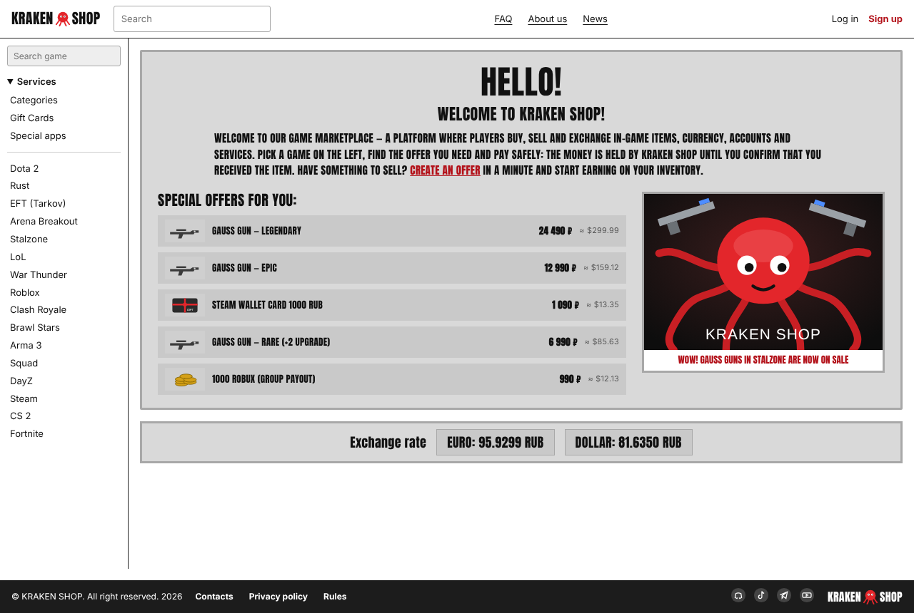
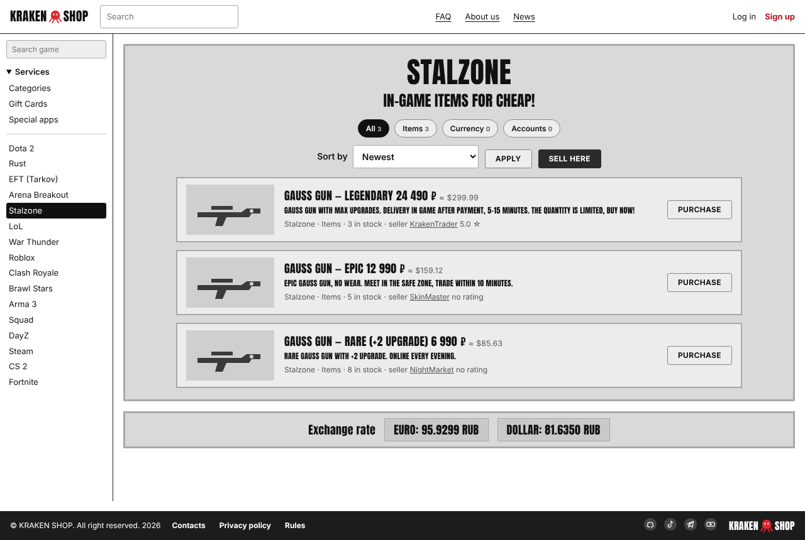
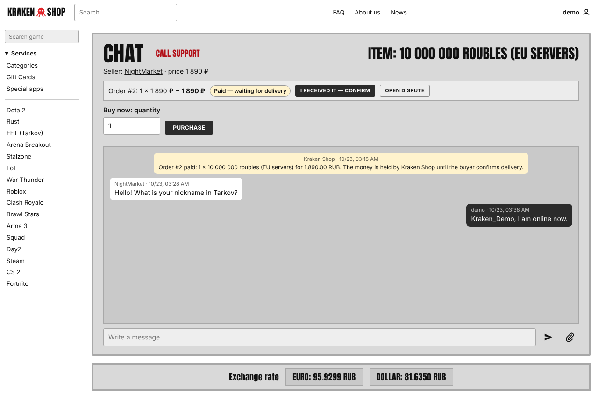
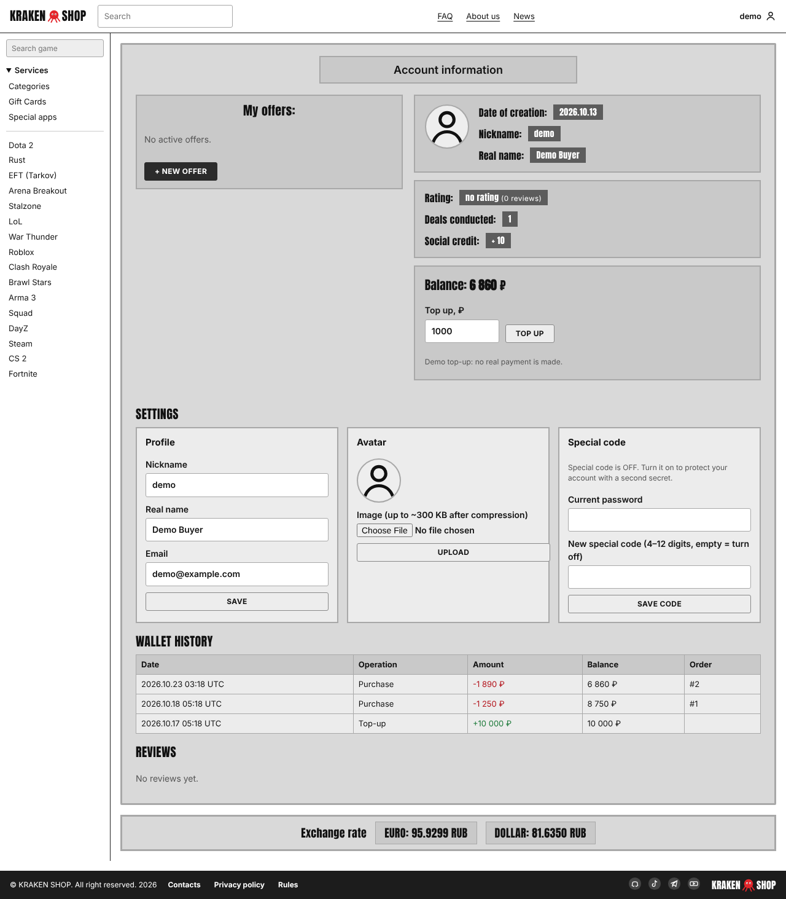

# Kraken Shop


**Биржа игровых ценностей**: предметы, валюта, аккаунты и услуги для 16 игр, подарочные карты и подписки. Безопасные сделки с заморозкой денег, чат с продавцом, отзывы, рейтинг и «Social credit».
Учебный проект ОПВ.15 (Express + Microsoft SQL Server + Docker + GitHub Actions).

📘 **Полное пошаговое руководство (VS Code / Visual Studio, SSMS, Docker, GitHub, как продолжать разработку): [docs/INSTRUCTIONS.md](docs/INSTRUCTIONS.md)**

| Главная | Игра | Чат сделки | Account information |
|---|---|---|---|
|  |  |  |  |

## Быстрый старт

Нужен **Node.js 22+**.

```bash
npm install
npm run demo          # без базы данных, данные в памяти → http://localhost:3000  (вход: demo / demo1234)
```

С настоящей базой SQL Server:
1. В SSMS выполните `database/01…04` и `06_app_login.sql` (подставьте свой пароль) — раздел 4 руководства.
2. `copy .env.example .env` и впишите пароль в `DB_PASSWORD`.
3. `npm start` (или F5 в VS Code → «Kraken Shop: run with SQL Server (.env)»).

Всё в Docker (сайт + SQL Server 2022, в `.env` нужен только `DB_PASSWORD`):
```bash
docker compose -f docker-compose.yml -f docker-compose.db.yml up --build
```

Тесты: `npm test`.

## Демо-аккаунты (из `04_seed.sql`, пароль у всех `demo1234`)

| Логин | Роль |
|---|---|
| `demo` | покупатель: баланс, сделки, чаты |
| `KrakenTrader` | продавец с отзывом 5 ☆ |
| `SkinMaster` | продавец |
| `NightMarket` | продавец с возвратом (отрицательный Social credit) |
| `KrakenTeam` | автор новостей |

## Что где лежит

| Путь | Что это |
|---|---|
| `server/app.js` | адреса сайта и API, проверки прав |
| `server/views.js`, `server/html.js` | HTML страниц по макету Kraken Shop |
| `server/mssqlRepo.js` | запросы к SQL Server; `memoryRepo.js` — то же в памяти (тесты, демо) |
| `public/` | стили, скрипты страниц, картинки, `robots.txt` |
| `database/` | SQL-скрипты для SSMS: база, 12 таблиц, процедуры, тестовые данные, запросы, логин приложения |
| `tests/` | автотесты (`node --test`): API, страницы, SEO, безопасность; те же сценарии — на настоящем SQL Server в CI |
| `Dockerfile`, `.dockerignore`, `docker-compose*.yml` | контейнеризация |
| `.github/workflows/build.yml` | CI: тесты → тесты на SQL Server → образ в GHCR |
| `docs/` | руководство, ER-диаграмма, скриншоты, SEO, Pull Requests |

## Страницы

`/` главная · `/games/:slug`, `/services/:slug` каталог · `/categories` · `/listings/:id` лот · `/users/:nick` профиль продавца ·
`/login`, `/register` · `/account` · `/sell` · `/deals` · `/chat`, `/chat/:id` · `/news` · `/faq` · `/about` · `/contacts` · `/privacy` · `/rules` · `/search`

## API (кратко)

`/api/auth/*` (register, login, logout, me) · `/api/users/me` (+ `/avatar`, `/special-code`) · `/api/users/:nick` ·
`/api/games` · `/api/listings` · `/api/conversations` (+ `/messages`, `/support`) · `/api/orders` (+ `/confirm`, `/dispute`, `/refund`, `/review`) ·
`/api/wallet` (+ `/deposit`) · `/api/news` · `/api/rates` · `/api/health`. Все ответы API — с `X-Robots-Tag: noindex, nofollow`.

## Безопасность (коротко)

Секреты только в `.env` (в Git и Docker не попадает). Пароли и Special code — хеш scrypt. SQL только с параметрами. HTML экранируется, CSP без inline-скриптов. Чат и сделку видят только участники. Деньги двигаются в хранимых процедурах с транзакциями. Подробно — раздел 10 руководства.
