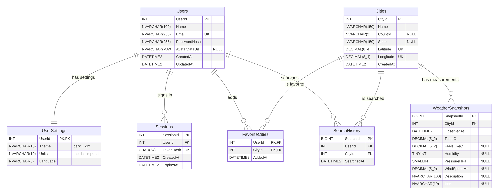
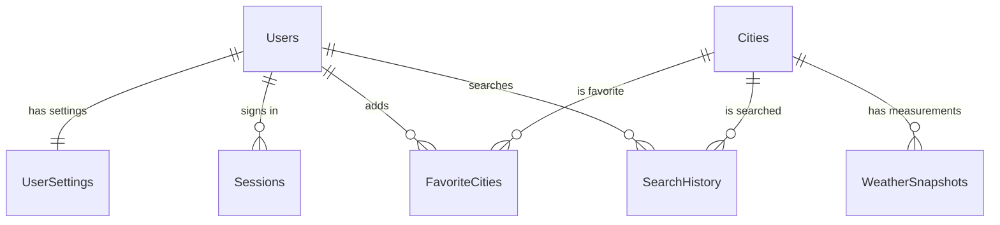

# База данных WeatherDb (Microsoft SQL Server)

Реляционная база данных для сайта погоды. СУБД — **Microsoft SQL Server 2022** (Express / Developer или контейнер Docker), управление — **SQL Server Management Studio (SSMS)**.

## ER-диаграмма

Исходник диаграммы — [`er-diagram.mmd`](er-diagram.mmd) (Mermaid, GitHub рисует его сам), векторная версия — [`er-diagram.svg`](er-diagram.svg).
В Mermaid нельзя писать запятую в типе, поэтому `DECIMAL(8_4)` означает `DECIMAL(8,4)`.

## Таблицы

| Таблица | Назначение | Ключи и связи |
|---|---|---|
| `Users` | Пользователи сайта: имя, email, хеш пароля (scrypt), аватар | PK `UserId`, UNIQUE `Email` |
| `UserSettings` | Тема (dark/light), единицы, язык | PK/FK `UserId` → Users, связь **1 : 1** |
| `Sessions` | Сессии входа (в cookie лежит токен, в БД — только его SHA-256) | FK `UserId` → Users, **1 : N** |
| `Cities` | Справочник городов (из OpenWeather Geocoding) | PK `CityId`, UNIQUE (`Latitude`, `Longitude`) |
| `FavoriteCities` | Избранные города пользователя | составной PK (`UserId`, `CityId`), связь **N : M** Users ↔ Cities |
| `SearchHistory` | История поиска городов | FK `UserId` → Users, FK `CityId` → Cities |
| `WeatherSnapshots` | Сохранённые замеры погоды (каждый запрос текущей погоды через сервер) | FK `CityId` → Cities, **1 : N** |

Дополнительно: представление `vw_CityLatestWeather` (последний замер по каждому городу), CHECK-ограничения (тема, координаты, влажность, email), индексы под частые запросы, `ON DELETE CASCADE` у всех внешних ключей.

## Скрипты (папка `database/`)

| Файл | Что делает |
|---|---|
| `01_create_database.sql` | создаёт базу `WeatherDb` |
| `02_schema.sql` | создаёт таблицы, ключи, ограничения, индексы, представление |
| `03_seed.sql` | тестовые данные (демо-пользователь `demo@example.com` / `demo1234`, 5 городов, избранное, история, замеры) |
| `04_queries.sql` | запросы для проверки и скриншотов (JOIN, GROUP BY, представление) |
| `05_app_login.sql` | отдельный логин `weather_app` с правами только на чтение/запись данных |

Все скрипты идемпотентные — их можно запускать повторно. Скрипты 01–03 можно выполнить в SSMS вручную или командой `npm run db:init`.
Пошаговая инструкция — в [`docs/INSTRUCTIONS.md`](../INSTRUCTIONS.md).
