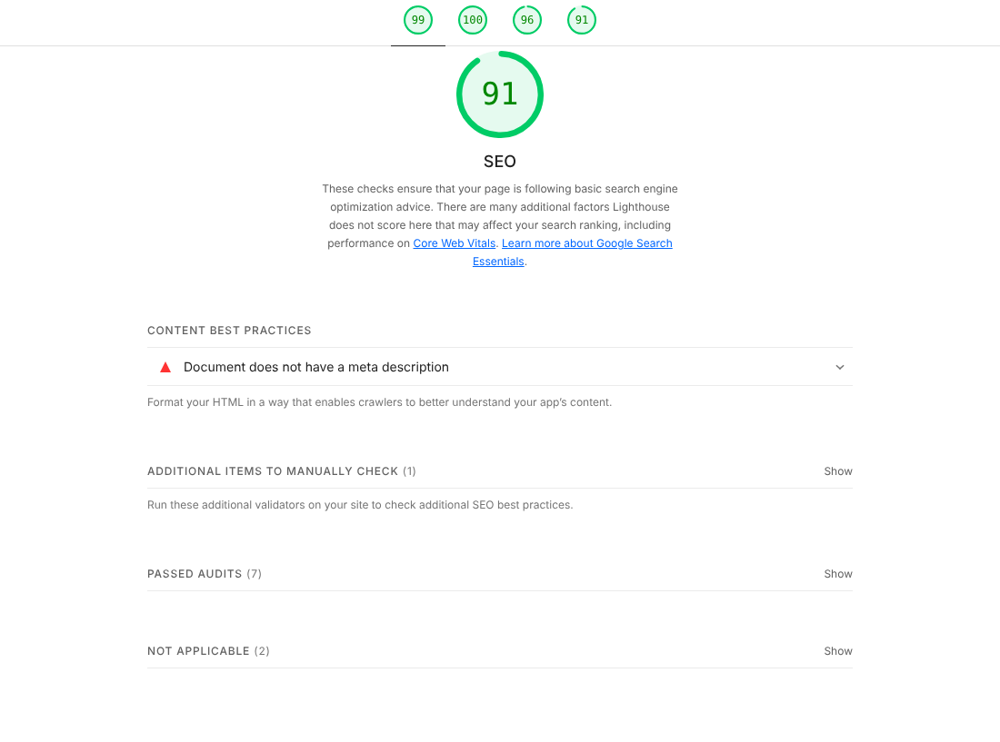
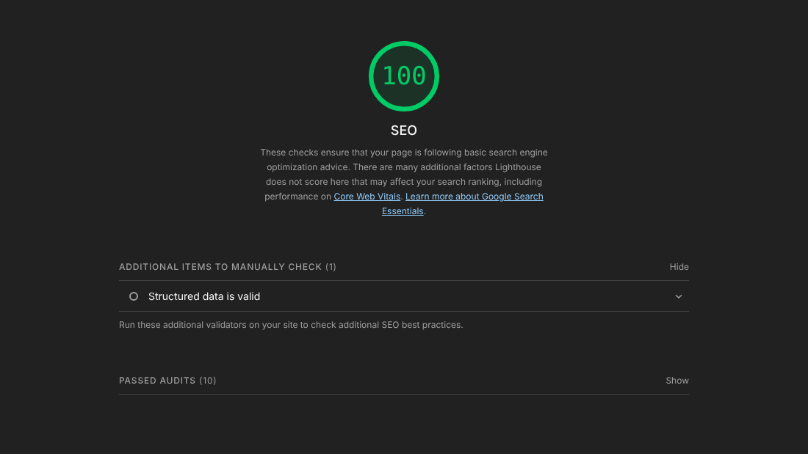

# SEO (практические занятия 70–71)

| Замер «до» | Замер «после» |
|---|---|
|  |  |

Главная страница, Lighthouse (Navigation, Desktop).
- **«До» — SEO 91:** первая версия проекта (статический сайт без `meta description`).
- **«После» — SEO 100:** Kraken Shop, запущенный в Docker (`docker compose -f docker-compose.yml -f docker-compose.db.yml up`). Остальные категории тоже 100: Performance, Accessibility, Best Practices. Те же 100 по SEO у страниц игры, лота, продавца и новостей.

Скриншоты сняты Lighthouse из командной строки. Для отчёта можно повторить замер в Chrome DevTools — порядок в `docs/INSTRUCTIONS.md`, раздел 11.

## Что сделано

- **Базовые метатеги** на каждой странице: `lang`, `charset`, `viewport`, свой `title` и `description` (их формирует сервер из данных БД: у лота — название, цена, игра, продавец), `canonical` и Open Graph (`og:title`, `og:type`, `og:url`, `og:image`, `og:image:alt`, `og:description`, `og:site_name`) на публичных страницах.
- **Структура заголовков:** логотип — это ссылка, а не `<h1>`; на каждой странице ровно один `<h1>` (HELLO!, название игры, название лота, «Account information», NEWS, CHAT…), ниже — `<h2>` без пропусков уровней; размер задаётся CSS-классами.
- **Серверная отрисовка:** публичные страницы приходят готовым HTML с данными из SQL Server — поисковику не нужно выполнять JavaScript.
- **Понятные адреса:** `/games/stalzone`, `/services/gift-cards`, `/listings/1`, `/users/KrakenTrader`, `/news`; старые `*.html` → 301 на адрес без `.html`.
- **robots.txt:** закрыты `/account`, `/deals`, `/chat`, `/sell`, `/login`, `/register`, `/search`, `/api/`; отдельная группа для Яндекса с `Clean-param` для UTM-меток; строка `Sitemap` с адресом из `SITE_URL`.
- **sitemap.xml генерируется из базы данных:** главная, категории, новости, текстовые страницы, все игры и сервисы, активные лоты и продавцы. Закрытых страниц в карте нет.
- **noindex** на страницах входа, регистрации, аккаунта, продажи, сделок, чатов, поиска и на 404.
- **X-Robots-Tag: noindex, nofollow** — middleware в `server/app.js` для всех ответов `/api/*`.
- **Скорость:** у изображений заданы `width`/`height`, картинки лотов загружаются лениво (`loading="lazy"`) и кешируются; шрифты с `display=swap`; иконки — лёгкие SVG.
- **Доступность (влияет на оценку Lighthouse):** контрастный красный для текста, подписи у полей, `aria-current` в меню, alt у картинок.

Всё это проверяется автотестами в `tests/api.test.js` (они же запускаются в GitHub Actions).

## Что осталось и почему

- Закрытые страницы закрыты и в `robots.txt`, и через `noindex` — так требует задание. Google и Яндекс советуют что-то одно: страницу, закрытую в `robots.txt`, робот не скачает и `noindex` не увидит. Эти страницы доступны только после входа, поэтому в поиск они всё равно не попадут.
- `SITE_URL` по умолчанию `https://example.com` — при публикации укажите настоящий домен в `.env`.
